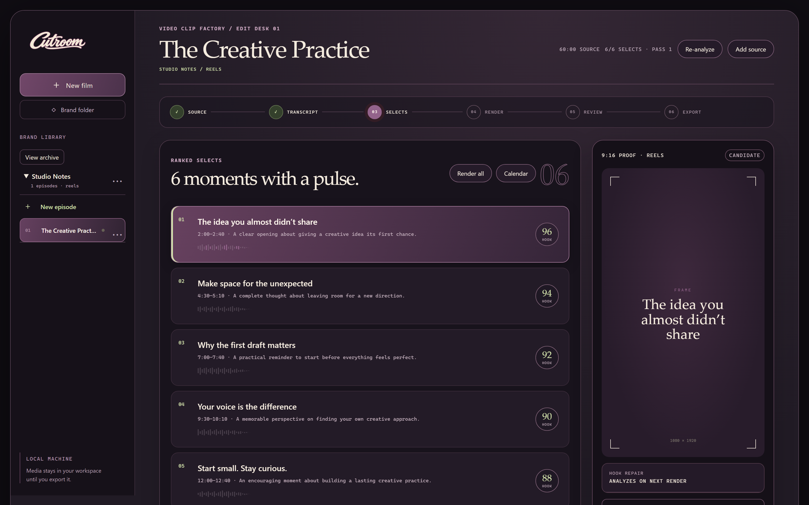
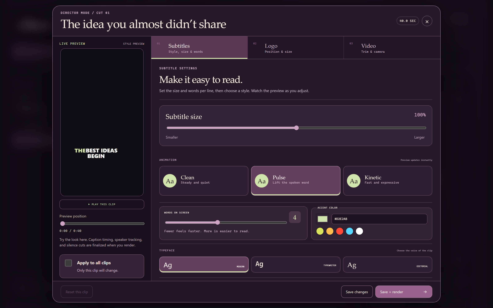
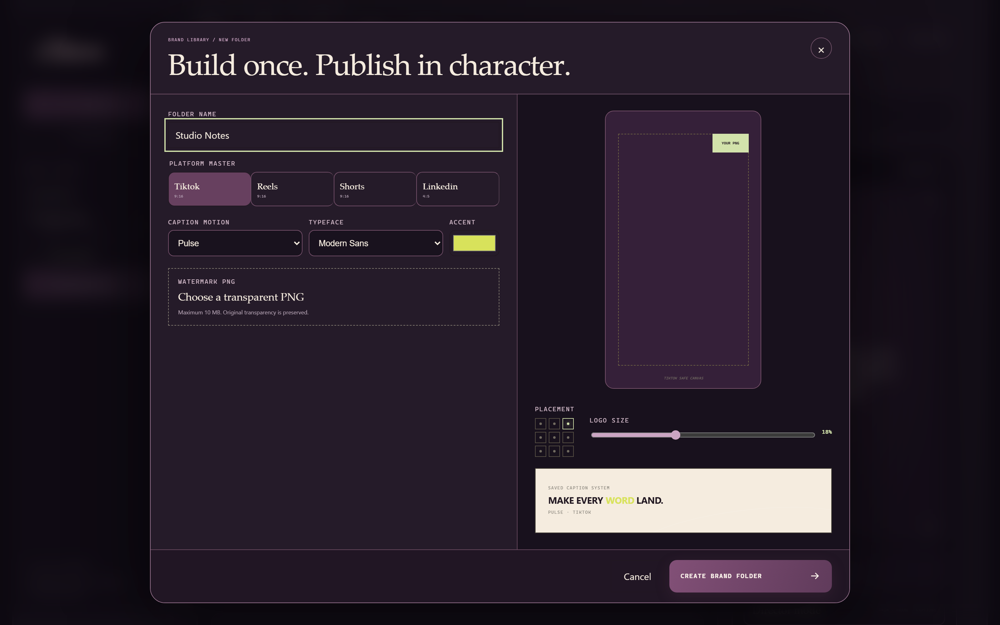

# A look inside Cutroom

The actual plum, ivory, and sage interface, captured at 2× display resolution
and saved as lossless WebP. Screenshots use fictional projects and synthetic
transcript text, supplied through intercepted API responses. They contain no
real episodes, customer data, private media, credentials, or account details.

## The workspace

Browse a collapsible brand library, review ranked moments, and select a clip.

## Director Mode

Edit caption style, animation, phrase length, typeface, size, and position.
The demo has no source video attached; the preview shows caption styling only.

## Brand folders

Set reusable platform, caption, and watermark defaults at the brand level.

These are interface demonstrations, not evidence of source-dependent rendering
quality. Read [verification boundaries](VERIFICATION.md) for those checks.

[Back to the product overview](../README.md)
